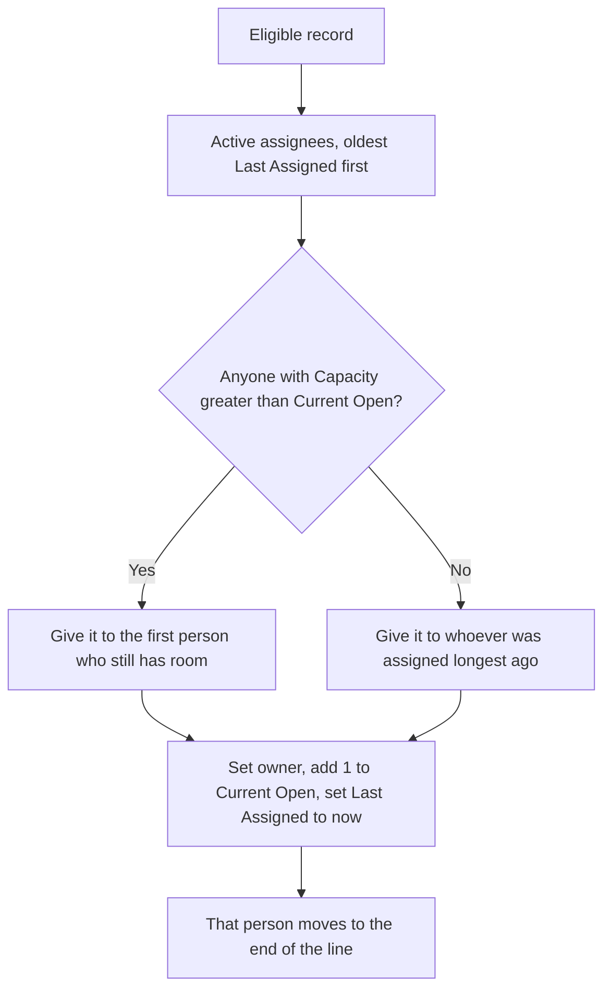
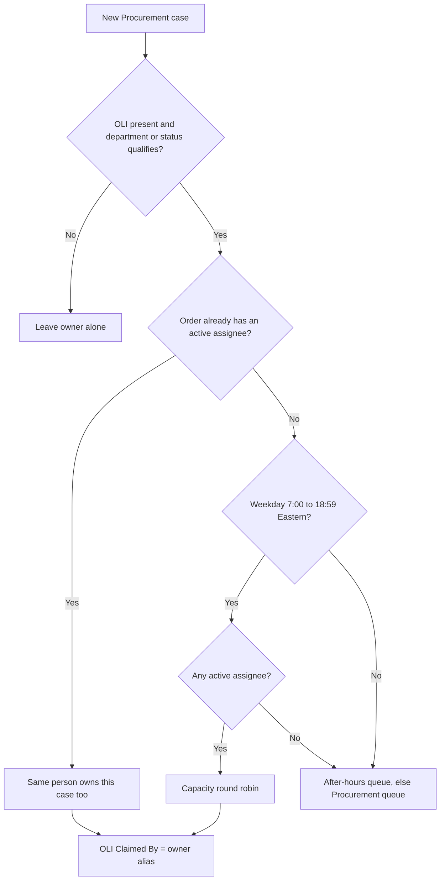

# Round Robin

How LDR assigns Procurement cases, Sales cases, and outbound BDR leads — for procurement, sales ops, and admins.

## What it is

A **Round Robin** is a named pool of users. When a Case or Lead is eligible, Salesforce picks the next active person in that pool and makes them the owner.

| Item | Detail |
| --- | --- |
| Pool | `Round_Robin__c` — name must match the path that uses it |
| People in the pool | `Round_Robin_Assignee__c` — one row per user, with Active, Capacity, and Last Assigned |
| Case flow | **Case - Round Robin** (`Case_Round_Robin`), after save on create and on owner change |
| Procurement picker | Apex `RR_Assignment` (capacity, then rotate) |
| Sales Case picker | The same flow, oldest **Last Assigned** |
| BDR leads | Apex `LeadRoundRobinAllocator`, pool name from routing control (default **Outbound BDR**) |
| Off switch | Hierarchy custom setting **Bypass Flows RR** skips the Case flow |

Pools in use:

| Pool name | Used for |
| --- | --- |
| `Procurement` | Procurement Cases. Name matches the Case record type. |
| `Sales Case` | Sales Cases. Name matches the Case record type. |
| `Outbound BDR` | Leads that lead routing sends to a BDR. Name comes from `BDR_Round_Robin_Name__c` on the active LDR routing control. |

## Setup

### Round Robin

| Field | What to set |
| --- | --- |
| Name | Exact pool name above. The Case flow looks up an **Active** pool whose name equals the Case record type name. |
| Active | Must be true or the pool is ignored. |
| After Hours Queue Id | Queue Id used when a Procurement case cannot be given to a person (nights, weekends, or nobody active). |

### Round Robin Assignee

| Field | What it does |
| --- | --- |
| User | Person who becomes the owner. |
| Active | Only active rows are picked. Turning Active on or off writes a line to **Activity History**. |
| Capacity | How many assignments this person should take before others with room are preferred. Blank is treated as 0. |
| Current Open | Running count of assignments. Each Apex assignment adds 1. Nothing in this repo subtracts it when a Case or Lead closes. |
| Last Assigned | When this person last received work. The next pick prefers the oldest timestamp. Blank sorts first. |
| Prior Last Assigned | Previous Last Assigned. A manual owner change restores Last Assigned from this value so giving a case away does not leave the person at the back of the line. |
| Activity History | HTML log of Active / Inactive changes. A weekly scheduled flow clears it (started 2025-05-11 at 22:00 UTC, weekly). |

BDR assignee setup defaults **Capacity** to 25 and **Current Open** to 0 when an admin setup job creates the row.

## How the next person is chosen

Procurement Apex and the BDR allocator use the same rule. Sales Cases use only the “oldest Last Assigned” half (they do not read Capacity or Current Open).

1. Load active assignees who have a user, oldest **Last Assigned** first (blank first, then by record Id).
2. Take the first person whose Capacity is still above Current Open.
3. If everybody is full, take the person at the front of that list anyway.
4. Add 1 to Current Open, set Last Assigned to now, and move that person to the end so the next record prefers someone else.

Once every assignee’s Current Open has reached Capacity, later assignments rotate by Last Assigned only. Current Open keeps climbing. To put someone back “under capacity,” an admin sets Current Open back down (or raises Capacity).

If the pool is missing, inactive, or has no active assignees, BDR leads fall back to the BDR queue (**Outbound BDR Queue** by default) and are marked **Needs Review**. Procurement cases fall back to a queue (next section). They are not left unowned by this process.

## Procurement cases

The flow runs when a Case is created or its owner changes, unless **Bypass Flows RR** is checked.

A **new** Procurement case is assigned only when it has an Order Line Item, and either:

- the line’s **Created By Department** is not **Non Emergency Project Management**, **Residential**, or **KAM**, or
- the Case status is **Schedule Confirmation** (this still assigns KAM, Residential, and Non Emergency Project Management lines).

| Situation | What happens |
| --- | --- |
| This Customer Order already has an active Procurement assignee | The new case goes to that same user, including nights and weekends. Current Open is not increased. OLI **Claimed By** is set to the owner’s alias. |
| Weekday, 7:00 a.m. through 6:59 p.m. Eastern, and someone is active | `RR_Assignment` picks the next person, sets Case owner, Case **RR Assignee**, **Assignment Date Time**, and the Order’s **RR Assignee**. OLI **Claimed By** becomes that user’s alias. A notification is published, including whether the line is an emergency. |
| Same window, but nobody is active | Owner becomes the pool’s **After Hours Queue**. If that Id is blank, owner becomes the **Procurement Queue**. |
| Nights, weekends | Same queue fallback. Business hours are Monday–Friday. The flow shifts UTC by 4 hours in daylight saving time and 5 hours otherwise so the clock is Eastern. |
| Several cases in one save share an Order | The first case picks the person. The rest of that save reuse them. Each of those Apex assignments still adds 1 to Current Open. |
| Later case on an Order that already has an assignee | The flow reuses that person and does not call the capacity picker. |

Default Case assignment rules are turned off for the Apex owner update so they do not overwrite the pick.

If **Claimed By** is updated and the owner’s alias is not a value on that picklist, the flow shows: `OLI Update Failed: Owner Alias is not an option in the Claimed By Picklist Field`.

## Sales cases

New Sales Cases do not use business hours or Capacity.

| Situation | Owner |
| --- | --- |
| The user who created the Case is already on the Sales Case pool | Stays with the creator. A notification is sent to them. |
| Creator’s Department is **National Account Management** or **Nat. Accounts Sales & Client Dev.** | Stays with the creator. A notification is sent to them. |
| Account has an Account Manager | Account Manager |
| Account has Business Development, and that user is an **active** Sales Case assignee — or they have no assignee row at all | Business Development |
| Account has Business Development, but their assignee row is **inactive** | Next person by oldest Last Assigned |
| No Account Manager and no Business Development | Next active assignee, oldest Last Assigned |

When the flow itself picks the next assignee, it sets Case owner and **RR Assignee**, stores the old Last Assigned in **Prior Last Assigned**, and sets Last Assigned to now. It does not change Current Open.

## Changing the owner by hand

The flow also runs when Case owner changes to a user (Id starts with `005`).

| Record type | What is updated |
| --- | --- |
| Sales Case | The previous assignee’s Last Assigned is put back to Prior Last Assigned. **RR Assignee** is cleared on the Case. |
| Procurement | The previous assignee’s Last Assigned is restored the same way. If the new owner is on the Procurement pool, that assignee is stamped on the Case and on the Customer Order, and OLI **Claimed By** is set to the new owner’s alias. If the new owner is not on the pool, **RR Assignee** is cleared on the Case and the Order. |

Giving a case to a queue does not run this manual-user path.

## Outbound BDR leads

Lead routing decides who should get the lead. Only some leads call the round robin. Purchased-list leads go to Marketing. A trade-show lead with an Event Rep goes straight to that rep. An existing account with an Account Manager goes to that PM. Enterprise accounts and net-new enterprise leads go to the enterprise review queue. Routing detail lives in [the lead routing handoff](../ldr-handoff/02-leads-routing-and-sla.md).

Leads that do reach the BDR pool:

| Lead | Why |
| --- | --- |
| Existing account, Business Development filled, buying motion not centralized or hybrid | Decentralized or blank buying motion goes to a BDR instead of NABDE. |
| Existing account, no PM, no Business Development, under enterprise size | BDR |
| Net-new lead with no employee count and no annual revenue | BDR, marked Needs Review |
| Net-new lead under the enterprise thresholds | BDR |
| Enrichment Failed or Partial | BDR, marked Needs Review |

The allocator locks the assignee rows, applies the capacity rule above, and writes:

| Lead field | Value |
| --- | --- |
| Owner | The chosen user, or the BDR queue if the pool or its people are missing |
| Routed To Role | BDR |
| Routing Status | Routed, or Needs Review when the route asked for review or the pool could not be used |
| Routing Reason / Routing Path | Why this lead took this path. A queue fallback appends the pool failure and `bdr_queue_fallback`. |

## Assignee activity log

Creating an assignee, or changing **Active**, prepends a line to **Activity History**: Eastern timestamp, the editor’s name, and Active or Inactive. The weekly scheduled flow blanks **Activity History** on every assignee. It does not reset Current Open or Last Assigned.

## What this does not cover

Trigger actions named Case Round Robin (before insert, after insert, after update) point at Apex class `CaseRoundRobinHandler` for Vendor Invoice Validation cases. That class is not in this repository, so this note does not describe that path.

`CaseRoundRobinFlowAction` can assign from the Order’s existing assignee or call `RR_Assignment` on weekdays 7:00–18:59 in the running user’s timezone. No flow in this repository calls it. The live Case path is **Case - Round Robin**.
